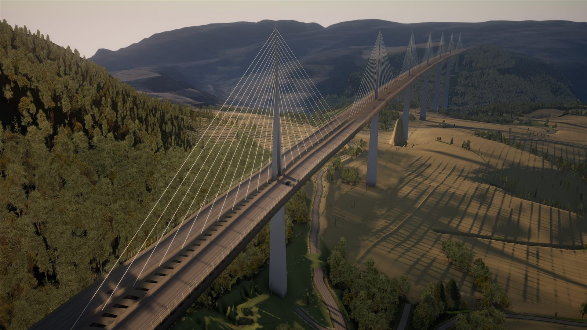
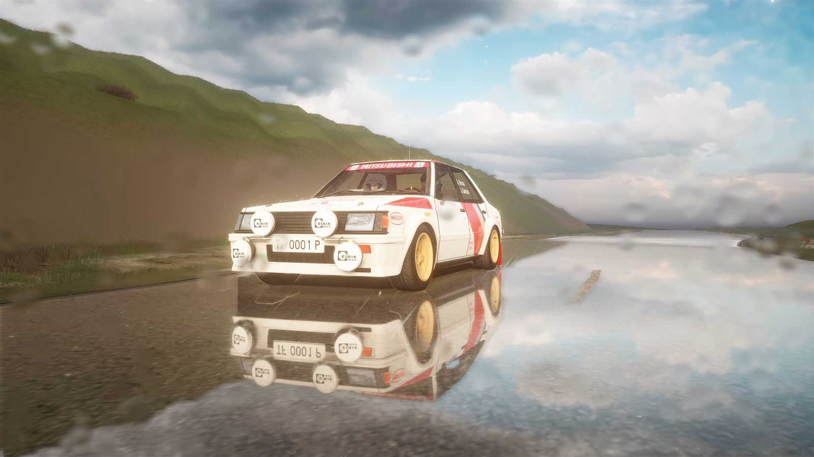
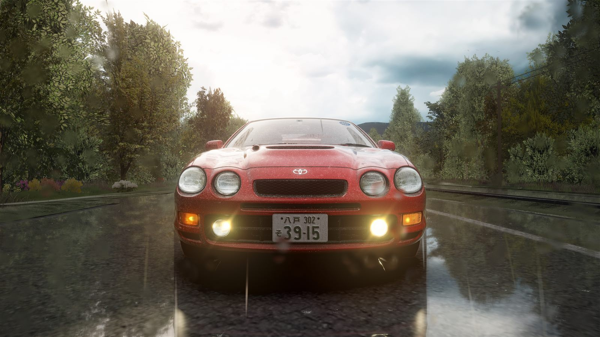
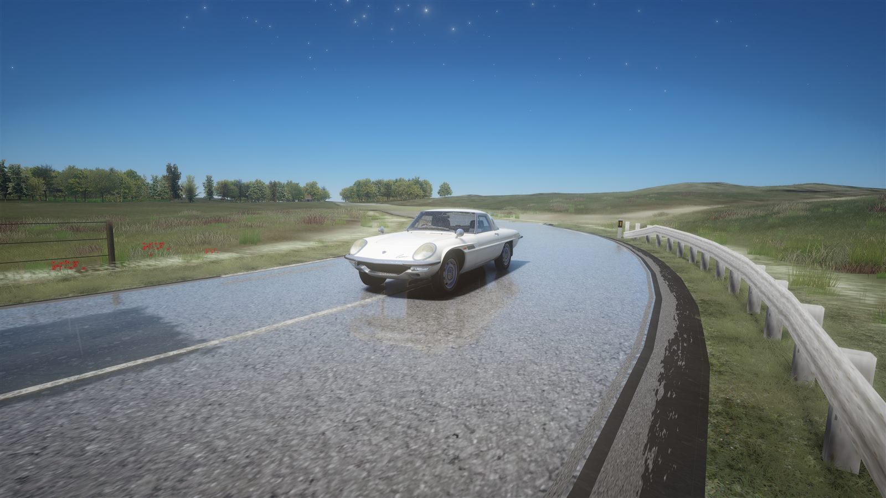

# ACTrackForge

**Ta route, dans Assetto Corsa.** Choisis une vraie route de France, trace ton parcours sur la carte, et ACTrackForge construit la piste : relief, photo aérienne, marquages, arbres et bâtiments, à partir des données ouvertes de l'IGN.

Gratuit, sans compte ni publicité. Tout le calcul se fait sur ton PC.



| | |
|---|---|
|  |  |
|  | *Captures en jeu, sur des pistes générées avec ACTrackForge (Millau, Foix, Utah Beach).* |

> **Version bêta.** Le logiciel est encore en développement : les pistes peuvent contenir des défauts (raccords, marquages, décor). Pour commencer, privilégie les **routes de campagne** : les villes, autoroutes et grands carrefours sont les plus délicats.

## ⬇ Télécharger

**[ACTrackForge pour Windows — dernière version](https://github.com/Pierro0871/ACTrackForge/releases/latest)**

Configuration :
- Windows 10 ou 11, 64 bits ;
- Microsoft Edge (déjà présent sur Windows) ou Google Chrome ;
- une connexion Internet, pour télécharger les données de la zone tracée ;
- Assetto Corsa, pour rouler sur les pistes.

## Installer

1. Télécharge `ACTrackForge.exe` depuis la page de la version, puis double-clique dessus.
2. **Windows affiche « Windows a protégé votre ordinateur » ?** C'est normal (voir plus bas). Clique sur **Informations complémentaires**, puis sur **Exécuter quand même**.
3. L'assistant s'ouvre : accepte les [conditions d'utilisation](CLUF.txt), choisis les raccourcis, puis clique sur **Installer**.
4. Le logiciel démarre, et un tutoriel guidé te montre comment créer ta première piste.

Aucun droit administrateur n'est nécessaire. Tes projets et tes pistes sont rangés dans `Documents\ACTrackForge`. Pour désinstaller : **Paramètres Windows › Applications › ACTrackForge › Désinstaller**.

### Pourquoi l'avertissement de Windows ?

Windows SmartScreen avertit pour tout programme téléchargé qui n'est pas signé par un certificat payant et que peu de personnes ont encore installé. ACTrackForge est un projet personnel et gratuit : il n'a pas ce certificat. L'avertissement ne signifie pas qu'un virus a été trouvé.

Pour vérifier que ton fichier est bien celui publié ici, compare son empreinte SHA-256 avec celle indiquée sur la page de la version. Dans PowerShell :

```powershell
Get-FileHash "$env:USERPROFILE\Downloads\ACTrackForge.exe" -Algorithm SHA256
```

## Utiliser

1. **Crée un projet** (« + Nouveau tracé ») et va à l'endroit de ton choix avec la barre de recherche.
2. **Trace ton parcours** en cliquant sur la carte : grâce à l'aimant, le tracé suit les vraies routes, comme un GPS.
3. **Choisis la qualité** : Express (essai rapide), Fluide (PC modeste), Équilibrée (recommandée) ou Haute (PC puissant).
4. **Génère**, puis clique sur **▶ Rouler dans Assetto Corsa**.

Trois types de piste sont possibles :
- **Tracé** : ton parcours, avec les débuts des routes qui s'y raccordent ;
- **Circuit** : une boucle de course ;
- **Monde ouvert** : une zone jusqu'à 3 × 3 km.

## Signaler un bug

Dans le logiciel, va dans **Paramètres › Signaler un bug**. Le message est préparé avec les infos techniques, tu peux joindre des captures, et il part depuis ta messagerie. Tu peux aussi écrire à **vintagecarsart@gmail.com**.

## Suivre le projet

- Instagram : [@actrackforge](https://www.instagram.com/actrackforge/) — nouveautés du logiciel
- Instagram : [@vintagecarsart](https://www.instagram.com/vintagecarsart/) — photo et design automobile
- TikTok : [@vintagecarsart](https://www.tiktok.com/@vintagecarsart)
- Facebook : [VintageCarsArt](https://www.facebook.com/VintageCarsArt/)

## Mentions

- ACTrackForge est un logiciel gratuit, distribué sous forme d'exécutable selon son [contrat de licence](CLUF.txt). Le code source n'est pas public.
- Données géographiques : © IGN – Géoplateforme (licence ouverte Etalab 2.0). Toute piste diffusée doit mentionner « © IGN ». Certaines couches viennent des contributeurs OpenStreetMap (ODbL).
- Musique de l'installateur : « Aphelion », Scott Buckley, sous licence CC BY 4.0 ([détails](licences/MUSIQUE.txt)).
- Polices : Saira Condensed, Barlow et JetBrains Mono, sous SIL Open Font License 1.1 ([licences](licences/)).
- Assetto Corsa est une marque de Kunos Simulazioni. ACTrackForge n'est ni affilié à Kunos Simulazioni, ni approuvé par elle.
